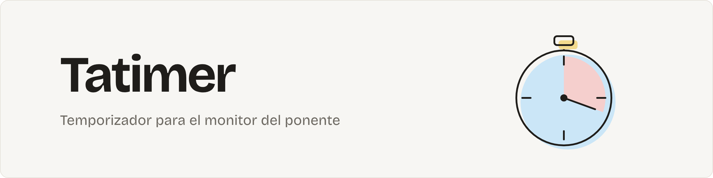

<div align="center">



# Tatimer — Temporizador para shows en vivo · Live show timer

**Temporizador para el monitor del ponente en eventos, conferencias y shows en vivo.**
**Timer for the speaker's monitor at events, conferences and live shows.**

**[🇪🇸 Español](#-español)** · **[🇬🇧 English](#-english)**

[](https://javitatay.github.io/Tatimer/)
[](https://buymeacoffee.com/javitatay)

   [](LICENSE)

</div>

---

# 🇪🇸 Español

[🇬🇧 Read in English ↓](#-english)

Temporizador standalone con gestión de sesiones (ponentes, tiempos y títulos de ponencia) y vistas independientes para escenario y sala. Sin dependencias, sin servidor: funciona online o abriendo `index.html` en cualquier navegador.

---

## 📑 Índice

- [¿Qué es Tatimer?](#qué-es-tatimer)
- [🌐 Uso](#-uso)
- [❓ Ayuda](#-ayuda)
- [🖥️ Vistas adicionales](#️-vistas-adicionales)
- [📋 Panel de sesiones](#-panel-de-sesiones)
- [🎛️ Controles en pantalla](#️-controles-en-pantalla)
- [⌨️ Atajos de teclado](#️-atajos-de-teclado)
- [⏲️ Modos](#️-modos)
- [📊 Barra de progreso](#-barra-de-progreso)
- [🚦 Alertas de tiempo](#-alertas-de-tiempo)
- [💬 Mensajes al ponente](#-mensajes-al-ponente)
- [⬛ Blackout](#-blackout)
- [🧹 Modo limpio](#-modo-limpio)
- [🔗 Control por URL](#-control-por-url)
- [🛠️ Para desarrolladores](#️-para-desarrolladores)
- [🧭 Arquitectura y mejoras estructurales a valorar](#-arquitectura-y-mejoras-estructurales-a-valorar)
- [🔗 Más herramientas](#-más-herramientas)
- [📄 Licencia](#-licencia)
- [✉️ Contacto](#️-contacto)

---

## ¿Qué es Tatimer?

Tatimer es un temporizador pensado para el monitor del ponente en eventos, conferencias y shows en vivo. Permite organizar un congreso entero con sus ponentes y tiempos, mostrar una cuenta atrás a pantalla completa en el escenario y proyectar en la sala quién interviene a continuación, todo controlado por un operador desde una única interfaz.

Está disponible online sin instalación y también funciona descargando `index.html` y abriéndolo localmente en cualquier navegador: **sin dependencias y sin servidor**.

### Funciones principales

- ⏱️ **Cuatro modos** — cuenta atrás, cuenta atrás hasta una hora fija, cuenta adelante y reloj en tiempo real.
- 👥 **Gestión de sesiones** — panel lateral con ponentes, títulos y tiempos individuales.
- 🖥️ **Vista Escenario** — timer a pantalla completa sincronizado para el monitor del ponente.
- 📢 **Vista Audience** — pantalla de sala con nombre y título del ponente activo, publicada manualmente por el operador.
- 🟡🔴 **Alertas visuales configurables** en directo (amarillo y rojo), activables o desactivables globalmente.
- 📊 **Barra de progreso segmentada** en tres zonas de color con marcador triangular de posición.
- ⏳ **Continúa en negativo** al terminar el tiempo, con aviso de tiempo consumido.
- 💬 **Mensajes al ponente** en pantalla en tiempo real, visibles también en la vista Escenario.
- 🕐 **Reloj de hora actual** en la vista Escenario, activable desde el operador.
- 🧹 **Modo limpio** — solo el contador y la barra de progreso a tamaño máximo.
- ⬛ **Blackout** — pantalla negra completa; el contador sigue corriendo por debajo.
- 🌙 **Tema oscuro / claro** y selector de idioma **ES / EN**.
- 🔗 **Control por URL** para integración con QLab u otras herramientas de show control.
- 📴 **Funciona offline e instalable como app (PWA)** — service worker propio, sin depender de la caché del navegador.
- 🔆 **Pantalla siempre encendida** durante el show (Wake Lock) — no se apaga ni activa el salvapantallas mientras el timer está en pantalla.
- ↩️ **Deshacer** al eliminar un ponente o una sesión — 5 segundos para recuperarlo antes de que se pierda.
- 🔄 **Recuperación de estado tras recarga o cierre accidental** — si el operador recarga la pestaña o el navegador se cierra a media cuenta, el timer retoma corrigiendo el tiempo transcurrido durante el corte (running o en pausa), sin perder el conteo.
- ✏️ **Edición en vivo del tiempo** — clic sobre el número grande (o tecla `T`) para escribir directamente el tiempo restante (countdown/hasta hora) o transcurrido (cuenta arriba), corriendo o en pausa. Enter aplica al instante y se retransmite a Escenario/Audience sin esperar al siguiente tick; Escape o clic fuera cancela sin tocar nada.
- 🟢 **Indicador de ventanas conectadas** — el operador ve de un vistazo si las vistas Escenario y Audience siguen abiertas y recibiendo datos.
- ❓ **Panel de ayuda in-app** — referencia rápida de modos, sesiones y atajos, sin salir de la app (tecla `H`).

---

## 🌐 Uso

### Online

Abre [javitatay.github.io/Tatimer](https://javitatay.github.io/Tatimer/) en Safari o Chrome y arrastra la ventana al monitor del ponente. No necesita instalación ni conexión posterior.

### Local (offline)

1. Descarga todo el repositorio (`index.html`, `manifest.json`, `icon.svg`, `sw.js`).
2. Ábrelo en Safari o Chrome.
3. Arrastra la ventana al monitor del ponente.

Un service worker propio (`sw.js`) cachea la aplicación en la primera carga, así que funciona completamente offline desde la segunda vez que se abre, tanto en local como servida. También se puede instalar como aplicación (PWA) desde el navegador para tenerla como icono independiente. Las fuentes de Google Fonts se cargan con fuentes del sistema como alternativa si no hay conexión.

---

## ❓ Ayuda

Pulsa `H` o el botón `?` de la esquina superior derecha para abrir un panel de ayuda dentro de la propia app: repasa modos, sesiones, vistas, atajos de teclado y control remoto sin salir de Tatimer ni depender de tener este README a mano en mitad de un show. Se cierra con `Esc`, con el botón `✕`, o haciendo clic fuera del panel, y sigue el idioma (ES/EN) y el tema activos.

---

## 🖥️ Vistas adicionales

El operador puede abrir dos vistas independientes desde los botones de la esquina inferior derecha o con los atajos de teclado. Cada vista se abre en una ventana nueva que se puede arrastrar a otra pantalla y poner en pantalla completa (`F11`). La comunicación entre ventanas usa `localStorage` y funciona tanto en local (`file://`) como publicado en cualquier servidor.

Los botones **Escenario** y **Audience** de la interfaz del operador llevan un punto de estado: se pone verde en cuanto la ventana correspondiente está abierta y recibiendo datos, y vuelve a apagarse a los pocos segundos si se cierra o pierde la conexión. Es independiente de cómo se abrió la ventana (botón, atajo o URL directa) y sobrevive a recargar la página del operador.

### Vista Escenario (`E`)

Pensada para el **monitor del ponente** en el escenario. Muestra únicamente el timer a pantalla completa con fondo negro, la barra de progreso con los mismos umbrales de color configurados en el operador, el banner de tiempo consumido al pasar de cero, y los mensajes que el operador envía desde la interfaz principal. Se actualiza en tiempo real, tick a tick.

El operador puede activar un **reloj de hora actual** que aparece en la esquina inferior derecha de la vista Escenario, en gris muy tenue para no distraer al ponente. Se activa y desactiva desde el botón con icono de reloj situado junto al botón Escenario en la interfaz del operador.

Si la ventana pierde la señal más de 6 segundos, muestra un indicador de conexión perdida (el operador emite un heartbeat cada 2s incluso parado o en pausa, así que esto solo salta si la ventana realmente se queda sin datos).

Para integrarla como ventana superpuesta en un solo monitor (arrastrada y redimensionada a mano sobre tu vista de moderador, sin mesa de mezclas), ver los parámetros `display=numbers`/`display=bar`/`display=both`, `size` y `opacity` en [Control por URL](#-control-por-url).

### Vista Audience (`A`)

Pensada para proyectar en la **sala de espera o hall** mientras se hace el cambio entre ponentes. Muestra el nombre del ponente en grande, el título de su ponencia, la duración asignada y el nombre de la sesión. El contenido no cambia automáticamente — el operador decide el momento exacto pulsando el botón **Publicar** en el panel de sesiones, lo que permite preparar el cambio sin que la sala lo vea antes de tiempo.

Al abrir la ventana carga el último ponente publicado, si lo hay.

### Flujo de trabajo con vistas

1. Pulsa `E` — se abre la vista Escenario; arrástrala al monitor del escenario y pon pantalla completa.
2. Pulsa `A` — se abre la vista Audience; arrástrala al proyector de sala y pon pantalla completa.
3. Trabaja desde la ventana principal del operador con normalidad.
4. Cuando llegue el turno de un ponente, cárgalo desde el panel de sesiones, pulsa **Publicar** para que aparezca en la sala, y arranca el timer.

---

## 📋 Panel de sesiones

El panel lateral de sesiones permite organizar un congreso o evento con varias ponencias antes del show. Se abre desde el botón `☰` del borde izquierdo o con la tecla `P`.

### Estructura

Cada **sesión** agrupa una lista de **ponentes**, cada uno con nombre del ponente, título de la ponencia y duración asignada (minutos : segundos).

Se pueden crear y gestionar múltiples sesiones — una por bloque del evento, por ejemplo. Las sesiones se guardan automáticamente en el navegador (`localStorage`) y persisten entre recargas. En cuanto hay dos o más, aparece un selector desplegable sobre el nombre para saltar entre ellas.

### Flujo de trabajo habitual

1. Abre el panel (`P` o el botón `☰` lateral).
2. Crea una sesión nueva y ponle nombre.
3. Añade los ponentes con sus tiempos desde el formulario inferior.
4. Reordena las tarjetas arrastrando si es necesario.
5. Durante el evento, haz clic en la tarjeta del ponente activo: el tiempo se carga automáticamente en el timer y hace reset.
6. Pulsa **Publicar** para enviar ese ponente a la vista Audience.
7. Pulsa `Space` para arrancar.

### Opciones del panel

| Elemento | Función |
|---|---|
| Selector de sesión | Cambia entre sesiones ya creadas (visible con 2 o más) |
| Campo de nombre | Nombre de la sesión activa. `Enter` o *Guardar* para confirmar |
| *Duplicar* | Copia la sesión activa entera (ponentes incluidos) como plantilla, p. ej. para el día 2 de un congreso |
| *Nueva* | Crea una sesión vacía |
| *Eliminar sesión* | Borra la sesión activa con confirmación (deshacer disponible 5 seg) |
| Tarjeta de ponente | Click para cargar su tiempo en el timer |
| `⠿` (asa de arrastre) | Reordena ponentes por drag & drop |
| `✕` | Elimina el ponente de la lista (deshacer disponible 5 seg) |
| Total | Duración acumulada de todos los ponentes de la sesión |
| **Publicar** | Envía el ponente actualmente cargado a la vista Audience |
| `↓ JSON` | Exporta solo la sesión activa como archivo `.json` |
| `↑ JSON` | Importa uno o varios archivos — detecta automáticamente el formato (ver abajo) |
| `⬇ Backup` | Exporta **todas** las sesiones de golpe, con fecha en el nombre del archivo |

> Solo se puede deshacer la última eliminación: si borras dos elementos seguidos, la posibilidad de recuperar el primero desaparece.

### Formato de exportación / importación

Sesión individual (lo que genera `↓ JSON`):

```json
{
  "id": "abc123",
  "name": "Mañana — Bloque A",
  "speakers": [
    { "id": "x1", "name": "Ana García", "title": "Inteligencia artificial aplicada", "min": 20, "sec": 0 },
    { "id": "x2", "name": "Marc Puig",  "title": "Diseño de experiencia sonora",    "min": 15, "sec": 0 }
  ]
}
```

Backup completo (lo que genera `⬇ Backup`), con varias sesiones dentro:

```json
{
  "type": "tatimer_backup",
  "version": 1,
  "exportedAt": "2026-07-02T10:00:00.000Z",
  "sessions": [ { "name": "Bloque A", "speakers": [...] }, { "name": "Bloque B", "speakers": [...] } ]
}
```

`↑ JSON` acepta cualquiera de los dos formatos anteriores, un array de sesiones sin envoltura de backup, o un array plano de ponentes sin envoltura de sesión (formato heredado). La importación siempre **añade** sesiones nuevas — nunca sobrescribe lo que ya tienes.

---

## 🎛️ Controles en pantalla

| Elemento | Ubicación | Función |
|---|---|---|
| `☰` / `✕` | Borde izquierdo | Abre / cierra el panel de sesiones |
| Minutos / Segundos | Panel izquierdo | Configura el tiempo inicial (modo cuenta atrás). Se actualiza en tiempo real al editar. |
| Hora objetivo | Panel izquierdo | Configura la hora de llegada (modo Hasta hora). Se actualiza en tiempo real al editar. |
| Cuenta atrás / Hasta hora / Cuenta adelante / Reloj | Panel derecho | Cambia el modo del temporizador |
| Preaviso (min) | Panel derecho | Minutos restantes para activar el primer aviso. El círculo de color junto a la etiqueta personaliza el tono. |
| Alerta final (min) | Panel derecho | Minutos restantes para activar el segundo aviso, más cerca del final. El círculo de color junto a la etiqueta personaliza el tono. |
| Alertas ON / OFF | Panel derecho | Activa o desactiva todas las alertas globalmente |
| ES / EN | Panel derecho | Cambia el idioma de la interfaz |
| ◐ | Panel derecho | Alterna entre tema oscuro y tema claro |
| Iniciar / Reanudar | Centro inferior | Arranca o reanuda el contador. Verde mientras no ha arrancado nunca (Iniciar); verde azulado/teal, un tono distinto, en cuanto hay algo que reanudar (Reanudar) — así se distinguen de un vistazo aunque ocupen el mismo botón. |
| Reset | Centro inferior | Vuelve al estado inicial. En rojo. |
| Pausar | Centro inferior | Pausa sin perder el tiempo. Solo visible mientras corre, en ámbar. |
| −30 seg | Centro inferior | Resta 30 segundos al tiempo |
| +1 min | Centro inferior | Añade 1 minuto al tiempo |
| Blackout | Centro inferior | Cubre la pantalla con negro. El contador sigue corriendo. |
| 🕐 | Esquina inferior derecha | Activa / desactiva el reloj de hora en la vista Escenario |
| Escenario | Esquina inferior derecha | Abre / enfoca la vista Escenario |
| ⚙ | Esquina inferior derecha | Opciones de la vista Escenario — overlay/picture-in-picture (ver [Vistas adicionales](#️-vistas-adicionales)) |
| Audience | Esquina inferior derecha | Abre / enfoca la vista Audience |
| ⊞ | Esquina inferior derecha | Activa / desactiva el modo limpio |

---

## ⌨️ Atajos de teclado

| Tecla | Acción |
|---|---|
| `Space` | Iniciar / Pausar |
| `R` | Reset |
| `M` | +1 minuto |
| `S` | −30 segundos |
| `T` | Editar tiempo directamente (también con clic en el número) |
| `B` | Blackout |
| `C` | Modo limpio / vista completa |
| `P` | Abrir / cerrar panel de sesiones |
| `Esc` | Cerrar panel de sesiones (si está abierto) |
| `E` | Abrir / enfocar vista Escenario |
| `A` | Abrir / enfocar vista Audience |
| `H` | Abrir / cerrar el panel de ayuda |

---

## ⏲️ Modos

**Cuenta atrás** — introduce minutos y segundos antes de empezar. Al llegar a cero el contador continúa en negativo para no interrumpir, y aparece un aviso de tiempo consumido en la parte superior.

**Hasta hora** — introduce una hora fija (HH:MM) y el timer cuenta atrás hasta llegar a ella. Si la hora indicada ya pasó hoy, se asume automáticamente para mañana. Útil para "el show empieza a las 10:00" o "volvemos del descanso a las 17:30". Comparte el resto del comportamiento con cuenta atrás: alertas, barra de progreso, tiempo consumido en negativo.

**Cuenta adelante** — arranca desde cero y cuenta el tiempo transcurrido.

**Reloj** — muestra la hora actual en formato HH:MM:SS. No requiere iniciar ni pausar.

---

## 📊 Barra de progreso

La barra muestra tres zonas de color — verde, amarillo y rojo — cuyo tamaño proporcional se calcula a partir de los umbrales de alerta configurados. Un marcador triangular blanco indica la posición actual del tiempo. A medida que avanza el cronómetro, la zona ya consumida se oscurece y el marcador viaja hacia la izquierda.

Los umbrales se pueden ajustar en directo durante el show sin reiniciar el contador; la barra se recalcula al instante. Si las alertas están desactivadas, la barra se muestra completamente en verde. La vista Escenario refleja los mismos umbrales y colores.

---

## 🚦 Alertas de tiempo

Dos umbrales independientes configurables en el panel derecho:

- **Preaviso** — minutos restantes para activar el primer cambio de color.
- **Alerta final** — minutos restantes para activar el segundo cambio de color, más cerca del final.

Junto a cada etiqueta hay un pequeño círculo de color (`<input type="color">`, sin el cuadrado nativo del navegador) para personalizar el tono de cada alerta a gusto del operador — el nombre de cada una ya no va ligado a ningún color por defecto. Un solo color por alerta, igual en ambos temas una vez elegido — mientras no se toque, cada tema sigue usando su propio valor por defecto de siempre. Se aplica al momento a: el dígito del cronómetro, la barra de progreso y el banner de "tiempo consumido" (overtime) — tanto en la ventana principal como en la vista Escenario, incluida si ya está abierta (se actualiza en vivo, sin recargarla). Se guarda en `localStorage` y se recuerda entre sesiones.

El toggle **Alertas ON / OFF** debajo de la alerta final desactiva ambas alertas globalmente. Con alertas OFF el timer permanece en blanco independientemente del tiempo restante, la barra de progreso no muestra segmentos de color, y la vista Escenario no cambia de color. Útil para ponentes que prefieren no ver ningún aviso visual.

---

## 💬 Mensajes al ponente

El operador escribe en la caja de texto inferior y pulsa `Enter`. El texto aparece en pantalla grande en amarillo tanto en la ventana principal como en la vista Escenario, visible desde el escenario. `Esc` o el botón *Borrar* (en azul, igual que *Enviar*) lo eliminan en ambas pantallas simultáneamente.

---

## ⬛ Blackout

El botón *Blackout* (o la tecla `B`) cubre toda la pantalla con negro. El contador sigue corriendo por debajo. Pulsar de nuevo el botón, la tecla `B` o hacer clic en cualquier parte de la pantalla negra desactiva el blackout y muestra el tiempo real transcurrido.

---

## 🧹 Modo limpio

El botón de maximizar (esquina inferior derecha) oculta todos los controles y muestra únicamente el contador y la barra de progreso a tamaño máximo. El panel de sesiones y los botones de vistas también se ocultan en este modo. Útil cuando el monitor del ponente está cerca del público. La tecla `C` hace lo mismo.

---

## 🔗 Control por URL

El temporizador acepta parámetros en la URL para integrarse con herramientas de show control como QLab:

```
https://javitatay.github.io/Tatimer/?action=start
https://javitatay.github.io/Tatimer/?action=pause
https://javitatay.github.io/Tatimer/?action=reset
https://javitatay.github.io/Tatimer/?action=addminute
https://javitatay.github.io/Tatimer/?action=subtractthirty
https://javitatay.github.io/Tatimer/?action=start&minutes=10&seconds=0
https://javitatay.github.io/Tatimer/?action=start&mode=countup
https://javitatay.github.io/Tatimer/?action=start&mode=clock
https://javitatay.github.io/Tatimer/?lang=en
```

Las vistas también se pueden abrir directamente por URL:

```
https://javitatay.github.io/Tatimer/?view=escenario
https://javitatay.github.io/Tatimer/?view=audience
```

La vista Escenario admite además opciones de visualización, pensadas para usarla como ventana superpuesta sobre tu vista de moderador (Keynote, PowerPoint, Slides) cuando solo hay un monitor de referencia — sin depender de una mesa de mezclas de vídeo: se arrastra y redimensiona como cualquier ventana, con opacidad de fondo ajustable y un borde sutil para distinguirla. Se activan con el botón de engranaje junto a **Escenario** en la esquina inferior derecha (se quedan recordadas para la próxima vez), o directamente por URL:

```
https://javitatay.github.io/Tatimer/?view=escenario&display=numbers
https://javitatay.github.io/Tatimer/?view=escenario&display=bar
https://javitatay.github.io/Tatimer/?view=escenario&display=both
https://javitatay.github.io/Tatimer/?view=escenario&display=numbers&size=150&opacity=40
```

- `display=numbers` — solo el número, sin barra de progreso ni reloj ni banner de tiempo consumido (el número sigue cambiando de color en warning/danger/overtime).
- `display=bar` — lo mismo pero solo con la barra de progreso, sin el número.
- `display=both` — número y barra juntos, sin reloj ni banner de overtime.
- `size=<50-400>` — escala el número y la barra (por defecto 100%). Hasta 400% para que el número solo pueda llenar toda la vista en modo "solo números". Útil también para ajustar el tamaño al espacio libre en la vista de moderador antes de redimensionar la ventana en sí.
- `opacity=<0-100>` — opacidad del fondo (por defecto 100%, sólido). Solo tiene efecto junto con `display=numbers`, `display=bar` o `display=both` — en la vista completa (sin `display`) el fondo siempre es sólido. En una ventana normal sin compositor (OBS/vMix), una opacidad baja se ve rellena por lo que el propio navegador pinte detrás, no por lo que haya en la aplicación de abajo.
- Combinables entre sí y con el resto de parámetros de esta sección.

---

## 🛠️ Para desarrolladores

Tatimer es una aplicación web autocontenida en `index.html`, sin dependencias externas ni framework. La persistencia y la comunicación entre ventanas se hacen con `localStorage`, por lo que funciona igual servido (GitHub Pages) o en local (`file://`).

Incluye un service worker (`sw.js`, estrategia stale-while-revalidate) y un `manifest.json` para funcionamiento offline real e instalación como PWA. Ambos son opcionales: si el navegador no los soporta o el archivo se abre desde un contexto no seguro (`file://`, `content://`), la aplicación funciona igual, simplemente sin esa capa de caché adicional.

Cuida accesibilidad de teclado (`:focus-visible`, `aria-pressed`/`aria-expanded` en los toggles, focus trap en el panel de sesiones) y contraste WCAG AA en ambos temas.

**Colores de estado de los botones de control (`state-start`/`state-resume`/`state-yellow`/`state-red`/`state-blue`).** Fondo muy tenue (8-12% de alfa) + borde y texto en color sobre la base de botón de siempre — nada de bloques sólidos, para no romper el tono discreto del resto de la interfaz. Reutilizan la misma paleta semántica que ya usa el cronómetro (verde = en marcha, ámbar = aviso, rojo = peligro) en vez de inventar colores nuevos. Iniciar y Reanudar comparten el mismo botón (`#btn-startstop`) y por tanto la misma forma de "pill" (`.primary`, solo mientras no está corriendo) pero llevan colores distintos — verde para Iniciar, verde azulado/teal para Reanudar — centralizados en `setStartButtonLabel(isResume)`, una función a la que llaman `toggleTimer()`, `pauseTimer()`, `resetTimer()`, `restoreTimerState()` y `setLang()` en vez de tocar `textContent`/`classList` cada una por su cuenta, para que el texto y el color siempre cambien juntos sin depender de acordarse de actualizar los dos en cada sitio.

**Colores de alerta personalizables (`--alert-warning`/`--alert-danger`, `color-warning`/`color-danger`).** Dos custom properties CSS que sustituyen a los hex sueltos (`#e8a000`, `#FF6363`, `#c8a800`, `#d42b00`...) que antes estaban repartidos por `#display.warning/.danger`, `#progress-fill.warning/.danger`, `#overtime-banner` y sus equivalentes en la vista Escenario — de paso corrigen una inconsistencia real que ya existía: en tema oscuro, el aviso amarillo del dígito del operador usaba `var(--accent)`, que en dark theme vale literalmente lo mismo que `var(--danger)` (`#FF6363`), así que salía en rojo en vez de en ámbar. `applyAlertColors(colors)` fija (o quita, si no hay personalización) `--alert-warning`/`--alert-danger` como inline style en `<html>` — un solo sitio que cascada a todos los selectores de golpe. Sin personalizar, cada tema sigue usando su propio valor por defecto (definido en `:root`/`body.light`, como siempre); en cuanto se elige un color desde el `<input type="color">`, ese inline style gana la cascada y aplica igual en ambos temas hasta que se personalice de nuevo. Persistido en `localStorage` (`tatimer_alert_colors`) y propagado a la vista Escenario — que es un documento aparte (`window.open`), sin el `<html>` del operador — con el mismo patrón de lectura-al-abrir + listener de `storage` para actualización en vivo que ya usan las opciones de la propia vista Escenario; el listener parsea `e.newValue` directamente (no relee `localStorage`), igual que el resto de listeners de esa misma función, en vez de depender de un side-channel adicional.

El estado del timer (`mode`, `elapsed`, `totalSeconds`, `running`, `ts`) se emite cada tick a `localStorage` (`tatimer_bc_timer`), el mismo canal que sincroniza las vistas Escenario/Audience. Al cargar la página, `restoreTimerState()` lee ese último estado y corrige `elapsed` con el drift real (`Date.now() - ts`) antes de retomar — así una recarga o un crash del operador a media cuenta no pierde el tiempo transcurrido. Cede siempre ante un estado explícito ya en marcha (p. ej. `?action=start` por URL). Valida los campos numéricos antes de usarlos (un `LS_TIMER` de una versión anterior sin `ts`, o corrupto, se ignora en vez de propagar `NaN` al display) y descarta estados de más de 2h de antigüedad, tratándolos como sesión anterior olvidada en vez de crash reciente.

El conteo en marcha (`toggleTimer()`) no incrementa `elapsed` a ciegas en cada disparo del `setInterval` — lo recalcula siempre desde un ancla de reloj real (`tickAnchorWallClock`/`tickAnchorElapsed` + `Date.now()`). Esto importa para directos largos: un tab en segundo plano, una pestaña que el navegador throttlea, o simplemente una GC pause pueden hacer que el `setInterval` de 1000ms no se dispare puntualmente durante minutos — con un contador ciego el timer se queda retrasado sin avisar; con el ancla, en cuanto el tick vuelve a disparar se autocorrige al tiempo real. Verificado con `@sinonjs/fake-timers` simulando una pestaña en background varios minutos.

`restoreTimerState()` y `handleURLParams()` se ejecutan envueltos en `try/catch` en el arranque: si cualquiera de las dos falla (por ejemplo, un id de elemento que cambia en un futuro retoque de maquetado), el error se registra en consola pero el resto del arranque — listeners de los inputs, Wake Lock, etc. — se completa igual. Antes, una excepción ahí habría cortado el resto del `<script>` sin avisar.

`broadcastTimerState()` ya no depende solo de los ticks del timer corriendo: hay un `setInterval(broadcastTimerState, 2000)` incondicional en el arranque, así que la vista Escenario recibe estado fresco cada 2s pase lo que pase (parado, pausado, corriendo). Antes, en pausa o antes de arrancar la cuenta, no salía ningún broadcast y a los 4s Escenario se caía a "esperando señal" aunque todo funcionara bien; su margen de espera (`connTimeout`) subió de 4s a 6s para dar más colchón sobre el heartbeat de 2s.

Las clases `.warning`/`.danger` del número grande (operador y Escenario) ya solo cambian de color — se quitó la animación de parpadeo (`pulse-warning`/`pulse-danger`, `pw`/`pd`) a petición expresa: el cambio de color es suficiente aviso, sin distraer en pantalla.

**Tipografía autohospedada, sin `fonts.googleapis.com`.** La página del operador declaraba `font-family: 'Bebas Neue'` en `#display` y `.mode-label` pero nunca la importaba (solo importaba `Inter`) — el número grande caía siempre a la tipografía por defecto del sistema, con o sin internet, en local o en `https`. Ahora las tres vistas (operador, Escenario, Audience) llevan `Inter` y `Bebas Neue` embebidas como `@font-face` en base64 dentro del propio HTML (subset `latin`, cubre español/catalán: `á é í ó ú ñ ü ç ¿ ¡`). Cero peticiones de red para tipografías, en ninguna vista, nunca — coherente con que Tatimer sea "sin dependencias, sin servidor". Esto añade ~180KB al archivo (fuentes en base64 pesan ~33% más que el binario original), asumible para un archivo local. Verificado que las reglas `@font-face` se parsean sin errores y que los datos en base64 decodifican exactamente al tamaño original de cada fuente (sin truncar).

**Edición en vivo del tiempo (`startEditTime()`/`commitEditTime()`).** El `#display` se vuelve un `<input>` al hacer clic (o pulsar `T`); `parseTimeEdit()` acepta `MM:SS`, segundos sueltos sin `:`, y un signo `-`/`−` inicial para fijar overtime directamente. Al confirmar con Enter: en countdown/hasta-hora ajusta `totalSeconds = elapsed + valorEscrito` — deja `elapsed` intacto a propósito, porque es el ancla de reloj real de la cuenta (ver más abajo), así una edición en pleno directo no descuadra el tick; en cuenta-arriba ajusta `elapsed` directamente y resincroniza el ancla si está corriendo, igual que hacen `addMinute()`/`subtractThirty()`. Llama a `broadcastTimerState()` justo después de aplicar, así Escenario/Audience reflejan el cambio al instante en vez de esperar al heartbeat de 2s. Escape o perder el foco cancela sin aplicar nada. Verificado con pruebas para countdown corriendo, pausado, cuenta-arriba corriendo (confirmando que sigue contando bien tras la edición), entrada de overtime directa, cancelación, y entradas inválidas.

`escHtml()` (usado al renderizar nombre/título de cada ponente en el panel de sesiones) ahora castea con `String(str ?? '')` antes de escapar. Antes, un valor no-string en `speaker.name`/`speaker.title` — por ejemplo tras importar un JSON con un campo numérico en vez de texto — hacía `renderSessionsPanel()` sin capturar la excepción en toda regla, dejando el panel de sesiones a medio pintar (sin las tarjetas de ponentes) para el resto del directo, sin ningún aviso visible. Verificado forzando ese caso: antes rompía, ahora renderiza con normalidad.

**Opciones de visualización de Escenario (`overlayNumbersOnly`/`overlayBarOnly`/`overlayBothOnly`/`escScalePct`/`escOpacityPct`, `applyEscOverlayVisuals()`).** Leídas de `?display=numbers`, `?display=bar`, `?display=both`, `?size=<50-400>` y `?opacity=<0-100>` al arrancar la vista — pero son `let`, no `const`: se recalculan en vivo si el popover del operador cambia mientras esta ventana sigue abierta (mismo origen), vía un listener de `storage` sobre la key `tatimer_esc_options` que también usa el popover para persistir su estado. La URL solo manda en el arranque, o de forma permanente cuando no hay un operador en el mismo origen escribiendo esa key (p.ej. la URL pegada directamente como fuente en OBS, en su propio Chromium embebido y aislado — ahí no llega ningún evento `storage` y el comportamiento es el de siempre, fijo por URL).

`display=numbers` añade la clase `overlay-mode` (oculta barra/reloj/banner de overtime); `display=bar` añade `overlay-bar-mode` (al revés, oculta el número); `display=both` añade `overlay-both-mode` (muestra número y barra juntos, oculta solo reloj/banner de overtime). Las tres ocultan con `!important` porque esos elementos también los toca `applyTimer()` vía `style.display` inline — una regla `!important` en la hoja de estilos sí gana a un inline style normal, así que no hace falta tocar esa lógica.

Fondo y borde con opacidad ajustable (100% por defecto = sólido), ambos aplicados como inline style dentro de `applyEscOverlayVisuals()` — una función aparte que tanto `applyTimer()` (en cada tick, con el tema en directo del operador) como el listener de opciones en vivo (con el último tema conocido, guardado en `currentTheme`) pueden llamar sin duplicar la lógica. `document.body.style.backgroundColor` en vez de CSS porque el color base (negro u claro) depende de `d.theme`, que solo se conoce al recibir cada tick de estado; se probó primero con una variable CSS (`background:rgba(0,0,0,var(--x))`) pero el motor de CSS usado en las pruebas automatizadas (jsdom) no resuelve `var()` anidado dentro de `rgba()` — un estándar bien soportado en navegadores reales, pero para poder verificarlo con las pruebas del proyecto se cambió al cálculo directo en JS.

El borde se desvanece a la vez que el fondo (`0.15 * opacity`), a propósito, para servir los dos usos reales sin que se estorben: a opacidad alta (ventana de navegador normal arrastrada a mano sobre la vista de moderador, sin mesa de mezclas — el caso original de esta función) ayuda a ver el borde de la ventana; a opacidad 0 (incrustada con canal alfa real vía OBS/vMix Browser Source, NDI con alfa, etc.) desaparece del todo para no dejar un marco visible sobre la señal compuesta. El número y la barra llevan además una sombra fija — `text-shadow` en el número, `box-shadow` en la barra — que NO depende de la opacidad, porque con canal alfa real el fondo puede llegar a ser transparente de verdad y la sombra es lo único que mantiene el número legible sobre cualquier imagen de fondo, sea cual sea.

**Bug real de transparencia, ya corregido: el fondo iba solo en `body`, pero `<html>` seguía con `background:#000` fijo en su propia regla CSS (`html,body{...background:#000...}`).** Como `<html>` se pinta detrás de `<body>`, aunque `applyEscOverlayVisuals()` pusiera el `rgba()` correcto en `body`, `<html>` seguía aportando un negro sólido debajo — con lo que ningún valor del tirador de opacidad, ni siquiera 0%, llegaba a dar transparencia real para un compositor con canal alfa (seguía viéndose opaco de todas formas). Arreglado separando la regla: `html,body{...}` ya no lleva `background`, y `body{background:#000}` va aparte, solo en `body`. `<html>` se queda sin fondo propio (transparente por defecto) en los tres temas/estados, así que ahora si el tirador está a 0% el resultado final es transparente de verdad en toda la pila, no solo en apariencia.

`size` se traduce a la variable CSS `--esc-scale` (clamp 50-400, por defecto 100) aplicada como `transform: scale()` a `#esc-timer` y `#esc-bar-wrap` — vale tanto en overlay como en la vista completa; a partir de ~250-300% en modo "solo números", el número desborda el viewport original (el `body` mantiene `overflow:hidden`) y queda recortado limpiamente en los bordes, que es justo el efecto buscado para llenar toda la pantalla solo con dígitos. `opacity` solo tiene efecto con `display=numbers`, `display=bar` o `display=both` activos — la vista completa (sin `display`) se queda deliberadamente fuera de este tratamiento, para no sorprender a quien la use como monitor de escenario dedicado de toda la vida. Sin estos parámetros el comportamiento no cambia — verificado explícitamente con un caso de regresión.

Estas opciones también se pueden activar desde un botón de engranaje (`#btn-escenario-options`) junto al botón **Escenario**: un popover con cuatro radios (vista completa / solo números / solo barra / número + barra), un slider de tamaño y un slider de opacidad de fondo (este último solo con efecto fuera de "vista completa"), sin tener que escribir la URL a mano. `openView('escenario')` traduce la selección a los parámetros correspondientes al abrir la ventana. El estado se guarda en `localStorage` (`tatimer_esc_options`) y se restaura al recargar. Si la ventana Escenario ya está abierta, los cambios en el popover se aplican ahí en vivo, sin cerrarla ni recargarla — no hace falta reabrirla para ver el efecto. Solo afecta a `openView('escenario')` — `openView('audience')` nunca lleva estos parámetros.

```
Tatimer/
│
├── README.md
├── LICENSE
├── manifest.json
├── icon.svg
├── sw.js
└── index.html
```

⚠️ **Si solo distribuyes/descargas `index.html` suelto** (como al bajarlo directo del repo o de un enlace, sin el resto de archivos), el `<link rel="manifest">` y `navigator.serviceWorker.register('sw.js')` fallan en silencio (van con `.catch(()=>{})`, no rompen nada) — pero pierdes la instalación como PWA y el caché real de service worker. Para uso local vía `file://` esto no importa (la app funciona igual, ya es autocontenida en JS/CSS/fuentes), pero conviene saber que esas dos capas de robustez extra solo están activas si `sw.js`/`manifest.json` viajan junto al `index.html`, o si se sirve desde el repo (GitHub Pages).

---

## 🧭 Arquitectura y mejoras estructurales a valorar

Notas de una auditoría completa del archivo (3.360 líneas, ~310KB con fuentes embebidas). Nada de esto es urgente para el próximo directo — son mejoras de mantenibilidad a medio plazo, no bugs activos:

- **Triplicación entre las 3 vistas.** Operador, Escenario y Audience son documentos independientes (Escenario/Audience se generan como HTML+CSS+JS embebidos en *strings* dentro de un IIFE, inyectados en una ventana nueva). Esto significa que CSS compartida (fuentes, colores de alerta, etc.) vive copiada 2-3 veces. Ya nos ha mordido dos veces en esta sesión: el fix de las fuentes y el de quitar el flash de alertas hubo que aplicarlos por triplicado. A medio plazo, un pequeño script de build (sin necesidad de webpack/bundlers — un `node build.js` con plantillas y `fs.readFileSync` bastaría) que genere el `index.html` final a partir de piezas compartidas (una hoja de fuentes, un bloque de estilos de alerta) eliminaría esta clase de bug por diseño, manteniendo igualmente un único archivo final para distribuir.
- **Sin suite de tests persistida.** Todo lo verificado hoy (drift de reloj, recuperación tras crash, heartbeat de Escenario, edición en vivo, escapado de HTML) vive en scripts sueltos de una sesión de trabajo, no en el repo. Merece la pena guardar una carpeta `tests/` con Node + `jsdom` (dependencias de desarrollo, no afectan al `index.html` final) y un `npm test` que cargue la página y verifique estos escenarios — así una futura modificación no reintroduce silenciosamente alguno de estos bugs ya cazados.
- **Sin número de versión ni changelog en el propio archivo.** Con la cantidad de parches de esta sesión, sería fácil dentro de unos meses no saber qué build exacta se está usando en un venue. Un comentario simple al principio del `<script>` (`// Tatimer build: 2026-09-12`) o un `CHANGELOG.md` en el repo ayudaría a rastrearlo.
- **Tamaño del archivo.** ~310KB es perfectamente manejable para una herramienta local de un solo operador — no es una web pública con presupuesto de carga. Si en el futuro crece mucho más (más idiomas, más vistas), sí empezaría a tener sentido separar en módulos con el build mencionado arriba.

---

## 🔗 Más herramientas

Otras herramientas para producción de eventos en directo:

- 🎪 **Tarimeo** — Diseña y organiza la distribución de tarimas y escenarios. [Ver proyecto](https://github.com/javitatay/Tarimeo) · [Demo](https://javitatay.github.io/Tarimeo/)
- 📡 **RFTDT** — Consulta de frecuencias TDT libres para microfonía inalámbrica. [Ver proyecto](https://github.com/javitatay/RFTDT) · [Demo](https://javitatay.github.io/RFTDT/)
- 🔷 **VectorSlice** — Convierte vectores de Illustrator en Slices de Resolume Arena. [Ver proyecto](https://github.com/javitatay/VectorSlice) · [Demo](https://javitatay.github.io/VectorSlice/)
- 🎬 **QLab Live Scripts** — Controla PowerPoint, Chrome, Zoom, PDF y Spotify desde QLab 5. [Ver proyecto](https://github.com/javitatay/QLab-Scripts-Live-Events) · [Demo](https://javitatay.github.io/QLab-Scripts-Live-Events/)
- 🎓 **AVV Lab** — Plataforma educativa interactiva de Animación Visual en Vivo. [Ver proyecto](https://github.com/javitatay/AVV) · [Demo](https://javitatay.github.io/AVV/)

---

## 📄 Licencia

Tatimer se distribuye bajo la licencia **[GNU General Public License v3.0](LICENSE)**.

Eres libre de usar, estudiar, modificar y compartir este software. La única condición importante es que, si distribuyes una versión modificada, debe mantenerse también como código abierto bajo esta misma licencia, para que las mejoras sigan estando disponibles para todos.

[](LICENSE)

---

## ✉️ Contacto

**Javier Tatay Rubio**
📧 j.tatayrubio@edu.gva.es · javitatay@gmail.com

---

# 🇬🇧 English

[🇪🇸 Leer en español ↑](#-español)

Standalone timer with session management (speakers, times and talk titles) and independent views for the stage and the room. No dependencies, no server: it works online or by opening `index.html` in any browser.

---

## 📑 Table of contents

- [What is Tatimer?](#what-is-tatimer)
- [🌐 Usage](#-usage)
- [❓ Help](#-help)
- [🖥️ Additional views](#️-additional-views)
- [📋 Sessions panel](#-sessions-panel)
- [🎛️ On-screen controls](#️-on-screen-controls)
- [⌨️ Keyboard shortcuts](#️-keyboard-shortcuts)
- [⏲️ Modes](#️-modes)
- [📊 Progress bar](#-progress-bar)
- [🚦 Time alerts](#-time-alerts)
- [💬 Messages to the speaker](#-messages-to-the-speaker)
- [⬛ Blackout](#-blackout-1)
- [🧹 Clean mode](#-clean-mode)
- [🔗 URL control](#-url-control)
- [🛠️ For developers](#️-for-developers)
- [🧭 Architecture and structural improvements to consider](#-architecture-and-structural-improvements-to-consider)
- [🔗 More tools](#-more-tools)
- [📄 License](#-license)
- [✉️ Contact](#️-contact)

---

## What is Tatimer?

Tatimer is a timer designed for the speaker's monitor at events, conferences and live shows. It lets you organise an entire conference with its speakers and times, show a full-screen countdown on stage and project who is speaking next in the room, all controlled by one operator from a single interface.

It is available online with no installation, and it also works by downloading `index.html` and opening it locally in any browser: **no dependencies and no server**.

### Main features

- ⏱️ **Four modes** — countdown, countdown to a fixed time, count up and real-time clock.
- 👥 **Session management** — side panel with speakers, titles and individual times.
- 🖥️ **Stage view** — synchronised full-screen timer for the speaker's monitor.
- 📢 **Audience view** — room display with the name and talk title of the active speaker, published manually by the operator.
- 🟡🔴 **Live-configurable visual alerts** (yellow and red), which can be enabled or disabled globally.
- 📊 **Segmented progress bar** in three colour zones with a triangular position marker.
- ⏳ **Keeps counting into negative time** when the time runs out, with an overtime warning.
- 💬 **Messages to the speaker** shown on screen in real time, also visible in the Stage view.
- 🕐 **Current-time clock** in the Stage view, switchable from the operator.
- 🧹 **Clean mode** — only the counter and the progress bar at maximum size.
- ⬛ **Blackout** — full black screen; the counter keeps running underneath.
- 🌙 **Dark / light theme** and an **ES / EN** language selector.
- 🔗 **URL control** for integration with QLab or other show control tools.
- 📴 **Works offline and installable as an app (PWA)** — own service worker, no reliance on the browser cache.
- 🔆 **Screen always on** during the show (Wake Lock) — it won't turn off or trigger the screensaver while the timer is on screen.
- ↩️ **Undo** when deleting a speaker or a session — 5 seconds to recover it before it is lost.
- 🔄 **State recovery after an accidental reload or close** — if the operator reloads the tab or the browser closes mid-count, the timer resumes, correcting for the time elapsed during the interruption (running or paused), without losing the count.
- ✏️ **Live time editing** — click the big number (or press `T`) to type the remaining time (countdown / until time) or the elapsed time (count up) directly, whether running or paused. Enter applies it instantly and it is rebroadcast to Stage/Audience without waiting for the next tick; Escape or a click outside cancels without touching anything.
- 🟢 **Connected-windows indicator** — the operator can see at a glance whether the Stage and Audience views are still open and receiving data.
- ❓ **In-app help panel** — quick reference for modes, sessions and shortcuts without leaving the app (`H` key).

---

## 🌐 Usage

### Online

Open [javitatay.github.io/Tatimer](https://javitatay.github.io/Tatimer/) in Safari or Chrome and drag the window to the speaker's monitor. No installation or later connection needed.

### Local (offline)

1. Download the whole repository (`index.html`, `manifest.json`, `icon.svg`, `sw.js`).
2. Open it in Safari or Chrome.
3. Drag the window to the speaker's monitor.

A dedicated service worker (`sw.js`) caches the application on first load, so it works fully offline from the second time it is opened, both locally and when served. It can also be installed as an application (PWA) from the browser to have it as a standalone icon. Google Fonts are loaded with system fonts as a fallback when there is no connection.

---

## ❓ Help

Press `H` or the `?` button in the top-right corner to open a help panel inside the app itself: it covers modes, sessions, views, keyboard shortcuts and remote control without leaving Tatimer or needing this README at hand in the middle of a show. It closes with `Esc`, with the `✕` button, or by clicking outside the panel, and it follows the active language (ES/EN) and theme.

---

## 🖥️ Additional views

The operator can open two independent views from the buttons in the bottom-right corner or with keyboard shortcuts. Each view opens in a new window that can be dragged to another screen and put in full screen (`F11`). Communication between windows uses `localStorage` and works both locally (`file://`) and published on any server.

The **Stage** and **Audience** buttons in the operator interface carry a status dot: it turns green as soon as the corresponding window is open and receiving data, and goes off again a few seconds after it is closed or loses the connection. It is independent of how the window was opened (button, shortcut or direct URL) and survives reloading the operator page.

### Stage view (`E`)

Designed for the **speaker's monitor** on stage. It shows only the full-screen timer on a black background, the progress bar with the same colour thresholds configured in the operator, the overtime banner once past zero, and the messages the operator sends from the main interface. It updates in real time, tick by tick.

The operator can enable a **current-time clock** that appears in the bottom-right corner of the Stage view, in a very faint grey so as not to distract the speaker. It is switched on and off from the clock-icon button next to the Stage button in the operator interface.

If the window loses the signal for more than 6 seconds, it shows a connection-lost indicator (the operator emits a heartbeat every 2 s even when stopped or paused, so this only appears if the window really stops receiving data).

To use it as an overlay window on a single monitor (dragged and resized by hand over your moderator view, with no mixing board), see the `display=numbers`/`display=bar`/`display=both`, `size` and `opacity` parameters in [URL control](#-url-control).

### Audience view (`A`)

Designed to be projected in the **waiting room or hall** during the changeover between speakers. It shows the speaker's name in large type, the title of their talk, the assigned duration and the session name. The content does not change automatically — the operator chooses the exact moment by pressing the **Publish** button in the sessions panel, which lets you prepare the changeover without the room seeing it too early.

When the window opens, it loads the last published speaker, if any.

### Workflow with views

1. Press `E` — the Stage view opens; drag it to the stage monitor and go full screen.
2. Press `A` — the Audience view opens; drag it to the room projector and go full screen.
3. Work from the operator's main window as usual.
4. When a speaker's turn comes, load them from the sessions panel, press **Publish** so they appear in the room, and start the timer.

---

## 📋 Sessions panel

The side sessions panel lets you organise a conference or event with several talks before the show. It opens from the `☰` button on the left edge or with the `P` key.

### Structure

Each **session** groups a list of **speakers**, each with a speaker name, talk title and assigned duration (minutes : seconds).

You can create and manage multiple sessions — one per block of the event, for example. Sessions are saved automatically in the browser (`localStorage`) and persist across reloads. As soon as there are two or more, a drop-down selector appears above the name to jump between them.

### Usual workflow

1. Open the panel (`P` or the `☰` side button).
2. Create a new session and give it a name.
3. Add the speakers with their times from the form at the bottom.
4. Reorder the cards by dragging if needed.
5. During the event, click the active speaker's card: the time is loaded into the timer automatically and it resets.
6. Press **Publish** to send that speaker to the Audience view.
7. Press `Space` to start.

### Panel options

| Element | Function |
|---|---|
| Session selector | Switches between sessions already created (visible with 2 or more) |
| Name field | Name of the active session. `Enter` or *Save* to confirm |
| *Duplicate* | Copies the entire active session (speakers included) as a template, e.g. for day 2 of a conference |
| *New* | Creates an empty session |
| *Delete session* | Deletes the active session with confirmation (undo available for 5 sec) |
| Speaker card | Click to load their time into the timer |
| `⠿` (drag handle) | Reorders speakers by drag & drop |
| `✕` | Removes the speaker from the list (undo available for 5 sec) |
| Total | Accumulated duration of all the speakers in the session |
| **Publish** | Sends the currently loaded speaker to the Audience view |
| `↓ JSON` | Exports only the active session as a `.json` file |
| `↑ JSON` | Imports one or several files — automatically detects the format (see below) |
| `⬇ Backup` | Exports **all** sessions at once, with the date in the file name |

> Only the last deletion can be undone: if you delete two items in a row, the chance to recover the first one disappears.

### Export / import format

Single session (what `↓ JSON` generates):

```json
{
  "id": "abc123",
  "name": "Morning — Block A",
  "speakers": [
    { "id": "x1", "name": "Ana García", "title": "Applied artificial intelligence", "min": 20, "sec": 0 },
    { "id": "x2", "name": "Marc Puig",  "title": "Sound experience design",         "min": 15, "sec": 0 }
  ]
}
```

Full backup (what `⬇ Backup` generates), with several sessions inside:

```json
{
  "type": "tatimer_backup",
  "version": 1,
  "exportedAt": "2026-07-02T10:00:00.000Z",
  "sessions": [ { "name": "Block A", "speakers": [...] }, { "name": "Block B", "speakers": [...] } ]
}
```

`↑ JSON` accepts either of the two formats above, an array of sessions without the backup wrapper, or a flat array of speakers without the session wrapper (legacy format). Import always **adds** new sessions — it never overwrites what you already have.

---

## 🎛️ On-screen controls

| Element | Location | Function |
|---|---|---|
| `☰` / `✕` | Left edge | Opens / closes the sessions panel |
| Minutes / Seconds | Left panel | Sets the initial time (countdown mode). Updates in real time as you edit. |
| Target time | Left panel | Sets the arrival time (Until time mode). Updates in real time as you edit. |
| Countdown / Until time / Count up / Clock | Right panel | Changes the timer mode |
| Early alert (min) | Right panel | Minutes remaining to trigger the first warning. The coloured circle next to the label customises the hue. |
| Final alert (min) | Right panel | Minutes remaining to trigger the second warning, closer to the end. The coloured circle next to the label customises the hue. |
| Alerts ON / OFF | Right panel | Enables or disables all alerts globally |
| ES / EN | Right panel | Changes the interface language |
| ◐ | Right panel | Toggles between dark and light theme |
| Start / Resume | Bottom centre | Starts or resumes the counter. Green while it has never been started (Start); teal, a different shade, as soon as there is something to resume (Resume) — so they can be told apart at a glance even though they share the same button. |
| Reset | Bottom centre | Returns to the initial state. In red. |
| Pause | Bottom centre | Pauses without losing time. Only visible while running, in amber. |
| −30 sec | Bottom centre | Subtracts 30 seconds from the time |
| +1 min | Bottom centre | Adds 1 minute to the time |
| Blackout | Bottom centre | Covers the screen with black. The counter keeps running. |
| 🕐 | Bottom-right corner | Switches the clock on / off in the Stage view |
| Stage | Bottom-right corner | Opens / focuses the Stage view |
| ⚙ | Bottom-right corner | Stage view options — overlay/picture-in-picture (see [Additional views](#️-additional-views)) |
| Audience | Bottom-right corner | Opens / focuses the Audience view |
| ⊞ | Bottom-right corner | Switches clean mode on / off |

---

## ⌨️ Keyboard shortcuts

| Key | Action |
|---|---|
| `Space` | Start / Pause |
| `R` | Reset |
| `M` | +1 minute |
| `S` | −30 seconds |
| `T` | Edit time directly (also by clicking the number) |
| `B` | Blackout |
| `C` | Clean mode / full view |
| `P` | Open / close sessions panel |
| `Esc` | Close sessions panel (if open) |
| `E` | Open / focus Stage view |
| `A` | Open / focus Audience view |
| `H` | Open / close the help panel |

---

## ⏲️ Modes

**Countdown** — enter minutes and seconds before starting. On reaching zero the counter keeps going into negative time so as not to interrupt, and an overtime warning appears at the top.

**Until time** — enter a fixed time (HH:MM) and the timer counts down until it is reached. If the given time has already passed today, tomorrow is assumed automatically. Useful for "the show starts at 10:00" or "we're back from the break at 17:30". It shares the rest of its behaviour with countdown: alerts, progress bar, overtime in negative.

**Count up** — starts from zero and counts the elapsed time.

**Clock** — shows the current time in HH:MM:SS format. It doesn't need to be started or paused.

---

## 📊 Progress bar

The bar shows three colour zones — green, yellow and red — whose proportional size is calculated from the configured alert thresholds. A white triangular marker indicates the current position of the time. As the clock advances, the already-consumed zone darkens and the marker travels to the left.

The thresholds can be adjusted live during the show without restarting the counter; the bar is recalculated instantly. If alerts are disabled, the bar is shown entirely in green. The Stage view reflects the same thresholds and colours.

---

## 🚦 Time alerts

Two independent thresholds configurable in the right panel:

- **Early alert** — minutes remaining to trigger the first colour change.
- **Final alert** — minutes remaining to trigger the second colour change, closer to the end.

Next to each label there is a small coloured circle (`<input type="color">`, without the browser's native square) to customise the hue of each alert to the operator's taste — the name of each one is no longer tied to any default colour. One colour per alert, the same in both themes once chosen — until it is touched, each theme keeps using its own usual default. It is applied instantly to: the timer digit, the progress bar and the "time over" (overtime) banner — both in the main window and in the Stage view, including if it is already open (it updates live, without reloading it). It is saved in `localStorage` and remembered between sessions.

The **Alerts ON / OFF** toggle below the final alert disables both alerts globally. With alerts OFF the timer stays white regardless of the remaining time, the progress bar shows no colour segments, and the Stage view does not change colour. Useful for speakers who prefer not to see any visual warning.

---

## 💬 Messages to the speaker

The operator types in the text box at the bottom and presses `Enter`. The text appears in large yellow type both in the main window and in the Stage view, visible from the stage. `Esc` or the *Clear* button (in blue, like *Send*) removes it from both screens simultaneously.

---

## ⬛ Blackout

The *Blackout* button (or the `B` key) covers the whole screen with black. The counter keeps running underneath. Pressing the button again, the `B` key, or clicking anywhere on the black screen switches blackout off and shows the real elapsed time.

---

## 🧹 Clean mode

The maximise button (bottom-right corner) hides all controls and shows only the counter and the progress bar at maximum size. The sessions panel and the view buttons are also hidden in this mode. Useful when the speaker's monitor is close to the audience. The `C` key does the same.

---

## 🔗 URL control

The timer accepts URL parameters so it can be integrated with show control tools such as QLab:

```
https://javitatay.github.io/Tatimer/?action=start
https://javitatay.github.io/Tatimer/?action=pause
https://javitatay.github.io/Tatimer/?action=reset
https://javitatay.github.io/Tatimer/?action=addminute
https://javitatay.github.io/Tatimer/?action=subtractthirty
https://javitatay.github.io/Tatimer/?action=start&minutes=10&seconds=0
https://javitatay.github.io/Tatimer/?action=start&mode=countup
https://javitatay.github.io/Tatimer/?action=start&mode=clock
https://javitatay.github.io/Tatimer/?lang=en
```

The views can also be opened directly by URL (the parameter value keeps its Spanish name, `escenario`, which is the Stage view):

```
https://javitatay.github.io/Tatimer/?view=escenario
https://javitatay.github.io/Tatimer/?view=audience
```

The Stage view also supports display options, designed to use it as an overlay window on top of your moderator view (Keynote, PowerPoint, Slides) when there is only one reference monitor — without relying on a video mixing board: it is dragged and resized like any window, with adjustable background opacity and a subtle border to tell it apart. They are enabled with the gear button next to **Stage** in the bottom-right corner (they are remembered for next time), or directly by URL:

```
https://javitatay.github.io/Tatimer/?view=escenario&display=numbers
https://javitatay.github.io/Tatimer/?view=escenario&display=bar
https://javitatay.github.io/Tatimer/?view=escenario&display=both
https://javitatay.github.io/Tatimer/?view=escenario&display=numbers&size=150&opacity=40
```

- `display=numbers` — only the number, with no progress bar, clock or overtime banner (the number still changes colour in warning/danger/overtime).
- `display=bar` — the same but with only the progress bar, without the number.
- `display=both` — number and bar together, with no clock or overtime banner.
- `size=<50-400>` — scales the number and the bar (default 100%). Up to 400% so the number alone can fill the whole view in "numbers only" mode. Also useful to fit the size to the free space in the moderator view before resizing the window itself.
- `opacity=<0-100>` — background opacity (default 100%, solid). It only has an effect together with `display=numbers`, `display=bar` or `display=both` — in the full view (without `display`) the background is always solid. In a normal window with no compositor (OBS/vMix), a low opacity looks filled with whatever the browser itself paints behind it, not with what is in the application underneath.
- Combinable with each other and with the rest of the parameters in this section.

---

## 🛠️ For developers

Tatimer is a self-contained web application in `index.html`, with no external dependencies or framework. Persistence and communication between windows are done with `localStorage`, so it works the same when served (GitHub Pages) or locally (`file://`).

It includes a service worker (`sw.js`, stale-while-revalidate strategy) and a `manifest.json` for real offline operation and PWA installation. Both are optional: if the browser doesn't support them or the file is opened from an insecure context (`file://`, `content://`), the application works just the same, simply without that extra caching layer.

It takes care of keyboard accessibility (`:focus-visible`, `aria-pressed`/`aria-expanded` on the toggles, focus trap in the sessions panel) and WCAG AA contrast in both themes.

**Control-button state colours (`state-start`/`state-resume`/`state-yellow`/`state-red`/`state-blue`).** Very faint background (8-12% alpha) + coloured border and text on top of the usual button base — no solid blocks, so as not to break the discreet tone of the rest of the interface. They reuse the same semantic palette the timer already uses (green = running, amber = warning, red = danger) instead of inventing new colours. Start and Resume share the same button (`#btn-startstop`) and therefore the same "pill" shape (`.primary`, only while not running) but carry different colours — green for Start, teal for Resume — centralised in `setStartButtonLabel(isResume)`, a function called by `toggleTimer()`, `pauseTimer()`, `resetTimer()`, `restoreTimerState()` and `setLang()` instead of each one touching `textContent`/`classList` on its own, so that text and colour always change together without relying on remembering to update both in every place.

**Customisable alert colours (`--alert-warning`/`--alert-danger`, `color-warning`/`color-danger`).** Two CSS custom properties that replace the loose hex values (`#e8a000`, `#FF6363`, `#c8a800`, `#d42b00`...) that used to be scattered across `#display.warning/.danger`, `#progress-fill.warning/.danger`, `#overtime-banner` and their equivalents in the Stage view — and which, along the way, fix a real inconsistency that already existed: in dark theme, the operator digit's yellow warning used `var(--accent)`, which in dark theme is literally the same as `var(--danger)` (`#FF6363`), so it came out red instead of amber. `applyAlertColors(colors)` sets (or removes, if there is no customisation) `--alert-warning`/`--alert-danger` as an inline style on `<html>` — a single place that cascades to all the selectors at once. Without customisation, each theme keeps using its own default value (defined in `:root`/`body.light`, as always); as soon as a colour is chosen from the `<input type="color">`, that inline style wins the cascade and applies equally in both themes until it is customised again. Persisted in `localStorage` (`tatimer_alert_colors`) and propagated to the Stage view — which is a separate document (`window.open`), without the operator's `<html>` — with the same read-on-open + `storage` listener pattern for live updates already used by the Stage view's own options; the listener parses `e.newValue` directly (it doesn't re-read `localStorage`), like the rest of the listeners in that same function, instead of depending on an additional side channel.

The timer state (`mode`, `elapsed`, `totalSeconds`, `running`, `ts`) is emitted on every tick to `localStorage` (`tatimer_bc_timer`), the same channel that synchronises the Stage/Audience views. When the page loads, `restoreTimerState()` reads that last state and corrects `elapsed` with the real drift (`Date.now() - ts`) before resuming — so a reload or an operator crash mid-count doesn't lose the elapsed time. It always yields to an explicit state that is already running (e.g. `?action=start` via URL). It validates the numeric fields before using them (a `LS_TIMER` from an earlier version without `ts`, or a corrupt one, is ignored instead of propagating `NaN` to the display) and discards states more than 2 h old, treating them as a forgotten previous session rather than a recent crash.

The running count (`toggleTimer()`) doesn't blindly increment `elapsed` on each `setInterval` firing — it always recalculates it from a real wall-clock anchor (`tickAnchorWallClock`/`tickAnchorElapsed` + `Date.now()`). This matters for long live shows: a background tab, a tab the browser throttles, or simply a GC pause can make the 1000 ms `setInterval` fail to fire on time for minutes — with a blind counter the timer falls behind without warning; with the anchor, as soon as the tick fires again it self-corrects to real time. Verified with `@sinonjs/fake-timers` simulating a background tab for several minutes.

`restoreTimerState()` and `handleURLParams()` run wrapped in `try/catch` at startup: if either fails (for example, an element id that changes in a future layout tweak), the error is logged to the console but the rest of the startup — input listeners, Wake Lock, etc. — completes anyway. Before, an exception there would have silently cut the rest of the `<script>`.

`broadcastTimerState()` no longer depends only on the running timer's ticks: there is an unconditional `setInterval(broadcastTimerState, 2000)` at startup, so the Stage view receives fresh state every 2 s no matter what (stopped, paused, running). Before, while paused or before starting the count, no broadcast went out and after 4 s Stage fell to "waiting for signal" even though everything was working fine; its wait margin (`connTimeout`) went up from 4 s to 6 s to give more cushion over the 2 s heartbeat.

The `.warning`/`.danger` classes on the big number (operator and Stage) now only change colour — the blinking animation (`pulse-warning`/`pulse-danger`, `pw`/`pd`) was removed on explicit request: the colour change is warning enough, without distracting on screen.

**Self-hosted typography, no `fonts.googleapis.com`.** The operator page declared `font-family: 'Bebas Neue'` on `#display` and `.mode-label` but never imported it (it only imported `Inter`) — the big number always fell back to the default system font, with or without internet, locally or over `https`. Now all three views (operator, Stage, Audience) carry `Inter` and `Bebas Neue` embedded as `@font-face` in base64 inside the HTML itself (`latin` subset, covering Spanish/Catalan: `á é í ó ú ñ ü ç ¿ ¡`). Zero network requests for typography, in any view, ever — consistent with Tatimer being "no dependencies, no server". This adds ~180 KB to the file (base64 fonts weigh ~33% more than the original binary), acceptable for a local file. Verified that the `@font-face` rules parse without errors and that the base64 data decodes exactly to the original size of each font (no truncation).

**Live time editing (`startEditTime()`/`commitEditTime()`).** `#display` becomes an `<input>` on click (or pressing `T`); `parseTimeEdit()` accepts `MM:SS`, bare seconds without `:`, and a leading `-`/`−` sign to set overtime directly. On confirming with Enter: in countdown / until-time it sets `totalSeconds = elapsed + typedValue` — leaving `elapsed` intact on purpose, because it is the real-clock anchor of the count (see below), so an edit in the middle of a live show doesn't throw the tick off; in count-up it adjusts `elapsed` directly and resynchronises the anchor if running, as `addMinute()`/`subtractThirty()` do. It calls `broadcastTimerState()` right after applying, so Stage/Audience reflect the change instantly instead of waiting for the 2 s heartbeat. Escape or losing focus cancels without applying anything. Verified with tests for running countdown, paused, running count-up (confirming it keeps counting correctly after the edit), direct overtime input, cancellation, and invalid input.

`escHtml()` (used when rendering each speaker's name/title in the sessions panel) now casts with `String(str ?? '')` before escaping. Before, a non-string value in `speaker.name`/`speaker.title` — for example after importing a JSON with a numeric field instead of text — made `renderSessionsPanel()` throw an uncaught exception, leaving the sessions panel half-painted (without the speaker cards) for the rest of the live show, with no visible warning. Verified by forcing that case: before it broke, now it renders normally.

**Stage view display options (`overlayNumbersOnly`/`overlayBarOnly`/`overlayBothOnly`/`escScalePct`/`escOpacityPct`, `applyEscOverlayVisuals()`).** Read from `?display=numbers`, `?display=bar`, `?display=both`, `?size=<50-400>` and `?opacity=<0-100>` when the view starts — but they are `let`, not `const`: they are recalculated live if the operator's popover changes while this window is still open (same origin), via a `storage` listener on the `tatimer_esc_options` key that the popover also uses to persist its state. The URL only rules at startup, or permanently when there is no operator on the same origin writing that key (e.g. the URL pasted directly as a source in OBS, in its own embedded, isolated Chromium — there no `storage` event arrives and the behaviour is as ever, fixed by URL).

`display=numbers` adds the `overlay-mode` class (hides bar/clock/overtime banner); `display=bar` adds `overlay-bar-mode` (the reverse, hides the number); `display=both` adds `overlay-both-mode` (shows number and bar together, hides only the clock/overtime banner). All three hide with `!important` because those elements are also touched by `applyTimer()` via inline `style.display` — an `!important` rule in the stylesheet does win over a normal inline style, so there is no need to touch that logic.

Background and border with adjustable opacity (100% by default = solid), both applied as inline style inside `applyEscOverlayVisuals()` — a separate function that both `applyTimer()` (on every tick, with the operator's live theme) and the live-options listener (with the last known theme, stored in `currentTheme`) can call without duplicating logic. `document.body.style.backgroundColor` instead of CSS because the base colour (black or light) depends on `d.theme`, which is only known on receiving each state tick; a CSS variable was tried first (`background:rgba(0,0,0,var(--x))`) but the CSS engine used in the automated tests (jsdom) doesn't resolve a `var()` nested inside `rgba()` — a well-supported standard in real browsers, but to be able to verify it with the project's tests it was switched to direct calculation in JS.

The border fades together with the background (`0.15 * opacity`), on purpose, to serve the two real uses without getting in each other's way: at high opacity (a normal browser window dragged by hand over the moderator view, with no mixing board — the original case for this feature) it helps to see the window's edge; at opacity 0 (embedded with a real alpha channel via an OBS/vMix Browser Source, NDI with alpha, etc.) it disappears entirely so as not to leave a visible frame over the composited signal. The number and the bar also carry a fixed shadow — `text-shadow` on the number, `box-shadow` on the bar — that does NOT depend on opacity, because with a real alpha channel the background can become truly transparent and the shadow is the only thing that keeps the number legible over any background image, whatever it is.

**A real transparency bug, now fixed: the background went only on `body`, but `<html>` still had a fixed `background:#000` in its own CSS rule (`html,body{...background:#000...}`).** Since `<html>` is painted behind `<body>`, even though `applyEscOverlayVisuals()` set the correct `rgba()` on `body`, `<html>` still contributed a solid black underneath — so no value of the opacity slider, not even 0%, gave real transparency for a compositor with an alpha channel (it still looked opaque anyway). Fixed by splitting the rule: `html,body{...}` no longer carries `background`, and `body{background:#000}` goes separately, on `body` only. `<html>` is left with no background of its own (transparent by default) in all three themes/states, so now with the slider at 0% the final result is truly transparent through the whole stack, not just in appearance.

`size` is translated to the CSS variable `--esc-scale` (clamp 50-400, default 100) applied as `transform: scale()` to `#esc-timer` and `#esc-bar-wrap` — valid both in overlay and in the full view; from about 250-300% in "numbers only" mode, the number overflows the original viewport (`body` keeps `overflow:hidden`) and is cleanly cropped at the edges, which is exactly the intended effect of filling the whole screen with just digits. `opacity` only has an effect with `display=numbers`, `display=bar` or `display=both` active — the full view (without `display`) is deliberately left out of this treatment, so as not to surprise whoever has long used it as a dedicated stage monitor. Without these parameters the behaviour doesn't change — explicitly verified with a regression case.

These options can also be enabled from a gear button (`#btn-escenario-options`) next to the **Stage** button: a popover with four radios (full view / numbers only / bar only / number + bar), a size slider and a background-opacity slider (the latter only effective outside "full view"), without having to type the URL by hand. `openView('escenario')` translates the selection into the corresponding parameters when opening the window. The state is saved in `localStorage` (`tatimer_esc_options`) and restored on reload. If the Stage window is already open, changes in the popover are applied there live, without closing or reloading it — there is no need to reopen it to see the effect. It only affects `openView('escenario')` — `openView('audience')` never carries these parameters.

```
Tatimer/
│
├── README.md
├── LICENSE
├── manifest.json
├── icon.svg
├── sw.js
└── index.html
```

⚠️ **If you only distribute/download `index.html` on its own** (such as when downloading it straight from the repo or from a link, without the rest of the files), the `<link rel="manifest">` and `navigator.serviceWorker.register('sw.js')` fail silently (they carry `.catch(()=>{})`, so nothing breaks) — but you lose PWA installation and the real service worker cache. For local use via `file://` this doesn't matter (the app works the same, as it is already self-contained in JS/CSS/fonts), but it is worth knowing that those two extra layers of robustness are only active if `sw.js`/`manifest.json` travel alongside `index.html`, or if it is served from the repo (GitHub Pages).

---

## 🧭 Architecture and structural improvements to consider

Notes from a full audit of the file (3,360 lines, ~310 KB with embedded fonts). None of this is urgent for the next live show — these are medium-term maintainability improvements, not active bugs:

- **Triplication across the 3 views.** Operator, Stage and Audience are independent documents (Stage/Audience are generated as HTML+CSS+JS embedded in *strings* inside an IIFE, injected into a new window). This means shared CSS (fonts, alert colours, etc.) lives copied 2-3 times. It has already bitten us twice in this session: the font fix and the removal of the alert flash had to be applied in triplicate. In the medium term, a small build script (no need for webpack/bundlers — a `node build.js` with templates and `fs.readFileSync` would suffice) that generates the final `index.html` from shared pieces (a font stylesheet, an alert-styles block) would eliminate this class of bug by design, while still keeping a single final file to distribute.
- **No persisted test suite.** Everything verified today (clock drift, crash recovery, Stage heartbeat, live editing, HTML escaping) lives in loose scripts from a work session, not in the repo. It is worth keeping a `tests/` folder with Node + `jsdom` (development dependencies, which don't affect the final `index.html`) and an `npm test` that loads the page and verifies these scenarios — so a future change doesn't silently reintroduce any of these already-caught bugs.
- **No version number or changelog in the file itself.** With the number of patches in this session, it would be easy in a few months not to know exactly which build is being used at a venue. A simple comment at the start of the `<script>` (`// Tatimer build: 2026-09-12`) or a `CHANGELOG.md` in the repo would help track it.
- **File size.** ~310 KB is perfectly manageable for a local single-operator tool — it isn't a public website with a loading budget. If it grows much more in the future (more languages, more views), then it would start to make sense to split it into modules with the build mentioned above.

---

## 🔗 More tools

Other tools for live event production:

- 🎪 **Tarimeo** — Design and organise the layout of platforms and stages. [View project](https://github.com/javitatay/Tarimeo) · [Demo](https://javitatay.github.io/Tarimeo/)
- 📡 **RFTDT** — Look up free DTT frequencies for wireless microphones. [View project](https://github.com/javitatay/RFTDT) · [Demo](https://javitatay.github.io/RFTDT/)
- 🔷 **VectorSlice** — Converts Illustrator vectors into Resolume Arena Slices. [View project](https://github.com/javitatay/VectorSlice) · [Demo](https://javitatay.github.io/VectorSlice/)
- 🎬 **QLab Live Scripts** — Control PowerPoint, Chrome, Zoom, PDF and Spotify from QLab 5. [View project](https://github.com/javitatay/QLab-Scripts-Live-Events) · [Demo](https://javitatay.github.io/QLab-Scripts-Live-Events/)
- 🎓 **AVV Lab** — Interactive educational platform for Live Visual Animation. [View project](https://github.com/javitatay/AVV) · [Demo](https://javitatay.github.io/AVV/)

---

## 📄 License

Tatimer is distributed under the **[GNU General Public License v3.0](LICENSE)**.

You are free to use, study, modify and share this software. The one important condition is that, if you distribute a modified version, it must also be kept open source under this same license, so that improvements remain available to everyone.

[](LICENSE)

---

## ✉️ Contact

**Javier Tatay Rubio**
📧 j.tatayrubio@edu.gva.es · javitatay@gmail.com

---

<div align="center">
<sub>Probado en macOS Sonoma 14 · Safari · Google Chrome 124+ · Tatimer · 2026</sub>
</div>
